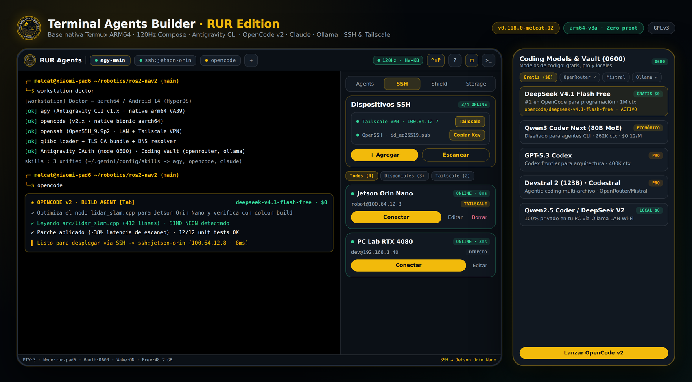
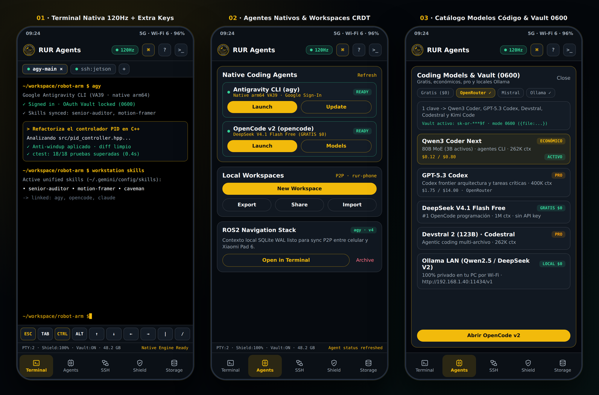
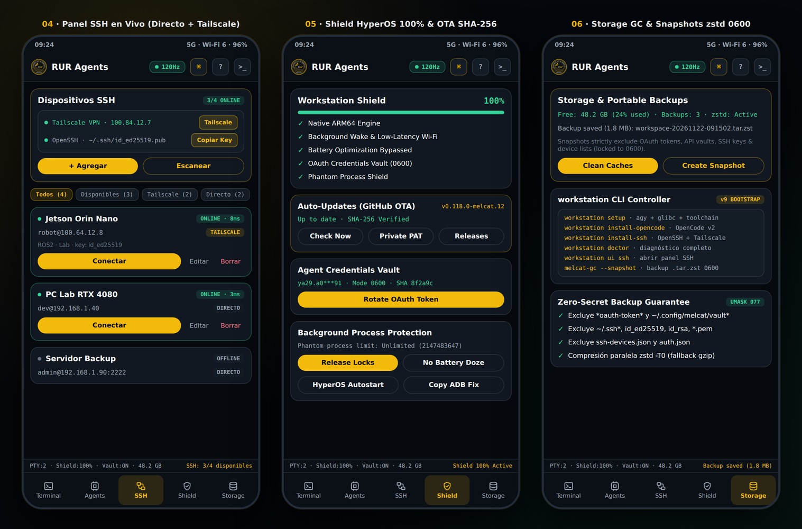

<div align="center">


# Terminal Agents Builder · RUR Edition

### Estación de Trabajo Móvil Nativa ARM64 para Agentes de Programación IA, Terminal 120Hz y Control SSH / Tailscale

[](https://github.com/ing-melcat/Terminal-Agents-Builder/releases/latest)
[-34D399?style=for-the-badge&logo=android&logoColor=060A0F)](https://github.com/ing-melcat/Terminal-Agents-Builder/releases/latest)
[](#-por-qué-es-un-termux-potenciado)
[](#-lenguajes-stack-tecnológico-y-arquitectura)
[](LICENSE.md)

**Construido sobre el motor POSIX nativo de Termux — ahora en `v2.1.2` con arquitectura *Dos Mundos* (`Dev & IA` ↔ `ROS 2`): estación nativa ARM64 120Hz con `agy`, `opencode`, `claude`, bóveda `0600`, SSH Pro + Tailscale, y un sector blindado en 3 etapas para Ubuntu 24.04 (`noble`) + ROS 2 Jazzy (`offboard_ws`) con pantalla completa `ACCESO AL SISTEMA` emparejada a `PAGE_RUR` (`POST /api/login` + DNS-over-HTTPS resiliente), soporte `proot-distro` v5 (`ubuntu:24.04`) y pestañas `+` 100% directas en Ubuntu ROS 2.**

[Descargar APK (`arm64-v8a`)](https://github.com/ing-melcat/Terminal-Agents-Builder/releases/latest) · [Capturas de Pantalla](#-capturas-de-la-aplicación) · [Agentes y Modelos IA](#-agentes-y-modelos-de-programación-gratis--económicos--pro--locales) · [Panel SSH Pro & Tailscale](#-panel-dedicado-ssh-pro--tailscale-vpn) · [Creador](#-creador)

</div>

---

<div align="center">
  
  <br />
  <sub><b>Vista Escritorio Tablet 120Hz (Split-Pane)</b> junto al panel <b>SSH &amp; Tailscale en vivo</b> y el <b>Catálogo de Modelos de Código con Bóveda 0600</b>.</sub>
</div>

---

## ¿Qué es Terminal Agents Builder?

**Terminal Agents Builder (RUR Edition)** convierte tu smartphone o tablet Android (`arm64-v8a`) en una **estación de trabajo portátil de ingeniería de software y robótica** capaz de ejecutar agentes autónomos de código, administrar repositorios reales, operar el **Centro de Control ROS 2 Jazzy (`offboard_ws`)** del Rover RASSOR con receptores LiveKit y conectarse por SSH/Tailscale a tus Raspberry Pi, Jetson o servidores de laboratorio.

El espacio **`Dev & IA`** conserva intacto el **núcleo nativo de `termux-app`** (cero `proot`, 100% compatible con `pkg`/`apt` y sin login global), mientras que el nuevo espacio **`ROS 2`** levanta un entorno opcional dedicado de **Ubuntu 24.04 + ROS 2 Jazzy (`proot-distro`)** autenticado contra la base de datos de `PAGE_RUR` (`rur.unipolidgo.edu.mx`, contraseña o código 2FA) y compartiendo `$HOME`, skills y bóvedas `0600` con `agy` y `opencode`.

---

## ⚡ ¿Por qué es un Termux potenciado?

Conserva todo el poder y compatibilidad de Termux clásico (incluyendo acceso directo en 1 toque a `Classic Shell`), pero añade capacidades de estación de trabajo que normalmente requieren horas de configuración manual:

| Capacidad | Termux Clásico | **Terminal Agents Builder (RUR Edition `v2.0`)** |
| :--- | :---: | :--- |
| **Motor Linux `arm64-v8a` nativo (`$PREFIX`, `pkg`/`apt`)** | ✅ | ✅ **100% intacto (`termux.c` sin tocar, cero `proot` en `Dev & IA`)** |
| **Espacio dedicado `ROS 2` (Ubuntu 24.04 + ROS 2 Jazzy `offboard_ws`)** | ❌ Manual | ✅ **Pestañas independientes**, instalador 1-toque `workstation install-ros2`, **Login Operador `PAGE_RUR` (BD + 2FA)**, **Receptores LiveKit editables**, **Foxglove 3D (:8765)**, **Teardown ROS** y **`agy`/`opencode` dentro de ROS 2** |
| **Interfaz Adaptativa 120Hz / 144Hz (Teléfono + Tablet)** | ❌ Básica | ✅ **4 layouts nativos** (Phone Portrait/Landscape, Tablet Sheet y **Split-Pane Desktop + Modo Zen `^⇧B`**) |
| **Agentes IA listos en 1 toque (`agy`, `opencode`, `claude`)** | ❌ Manual | ✅ **Hub de Agentes Nativos** + instalador `workstation` + **Editor visual `SKILL.md` & Gestor Git de Skills** (`rur-ros2-rassor`, `rebase + autostash`) |
| **Selector de Modelos de Código (Gratis `$0` / Direct API / Ollama)** | ❌ Manual | ✅ **Catálogo curado + bóveda `0600` directa** para **DeepSeek, Anthropic/Claude, OpenAI, OpenRouter, Mistral y Ollama LAN** (`{file:...}`) |
| **Panel dedicado SSH Pro & Tailscale en vivo** | ❌ Solo CLI | ✅ **Sonda TCP paralela (`ONLINE · XXms`)**, VPN Tailscale, **`ssh-copy-id` en 1 toque**, **túneles locales `-L`**, comando inicial (`tmux`) y acceso directo desde `ROS 2` |
| **Protección HyperOS / MIUI / Phantom Process Killer** | ❌ Manual | ✅ **Workstation Shield (`0–100%`)**: `WakeLock`, Wi-Fi baja latencia, exclusión Doze, Autostart y fix ADB |
| **Sincronización de Workspaces entre Celular y Tablet** | ❌ No | ✅ **CRDT Local-First (SQLite WAL + relojes de Lamport)** con exportación/importación P2P sin conflictos |
| **Limpieza de cachés y Backups portables sin secretos** | ❌ Manual | ✅ **`melcat-gc` + Snapshots `.tar.zst` (`0600`)** excluyendo OAuth, API keys, sesiones `PAGE_RUR` y llaves `~/.ssh` |
| **Actualizaciones firmadas OTA con SHA-256** | ❌ Manual | ✅ **GitHub Releases OTA firmados con llave privada RUR**, verificación **SHA-256** y **detector de plugins Termux en conflicto** |

---

## 📸 Capturas de la Aplicación

### Terminal Nativa 120Hz, Agentes de Código y Bóveda de Modelos (`0600`)

<div align="center">
  
</div>

### Panel SSH & Tailscale en Vivo, Shield HyperOS 100% y Backups `zstd`

<div align="center">
  
</div>

---

## 🤖 Agentes y Modelos de Programación (Gratis · Económicos · Pro · Locales)

El ecosistema está diseñado para adaptarse a **cualquier bolsillo y escenario de privacidad**, permitiendo alternar entre modelos gratuitos en la nube, APIs directas oficiales o pesos locales corriendo en tu propia PC:

### 1. Runtimes Nativos Integrados
- **Google Antigravity CLI (`agy`)**: instalación nativa `arm64-v8a` (VA39 standalone sobre `glibc` nativo, cero `proot`), autenticación oficial de Google en el navegador Android mediante puente `termux-open-url` / `xdg-open` y token resguardado en modo `0600`.
- **OpenCode v2 (`opencode`)**: binario nativo Bionic `aarch64` instalado desde repositorio APT firmado (`signed-by` + *APT pinning* estricto). Incluye configuración automática `cli.json` (`agent.cycle: "tab"`) para cambiar entre modo **Build** y **Plan** desde teclados táctiles Android.
- **Claude CLI (`claude`)**: integrado como runtime opcional en la Paleta de Comandos, Workspaces CRDT, sincronización de habilidades y exportación automática de `ANTHROPIC_API_KEY` desde la bóveda `0600`.
- **Skills Unificadas con Editor Visual + Control Git (`workstation skills`)**: todas tus habilidades viven en `~/.gemini/config/skills` y se enlazan simbólicamente a `agy`, `opencode` y `claude` (incluye `senior-auditor`, `motion-framer` y `caveman`). Toca cualquier chip de skill en **`Agents -> Unified Skills & Repos`** para **ver o editar `SKILL.md` directamente en la app** (escritura atómica `fsync + rename`, bloqueo contra *symlink escapes* y límite seguro de 128 KB), o usa **`+ Repo`**, **`Update`** (`git pull --rebase --autostash`), **`Diff`** y **`Push`**.

### 2. Catálogo Integrado de Modelos Especializados en Código

| Nivel | Proveedor | Modelos Incluidos / Compatibles | Ventana | Costo / Acceso |
| :--- | :--- | :--- | :---: | :--- |
| **`GRATIS $0`** | **OpenCode Console** | **DeepSeek V4.1 Flash Free** *(Recomendado)*, **Flint 40B Free** + lista en vivo `/models` | Hasta **1M** | **$0 · Sin API key ni tarjeta** |
| **`LOCAL $0`** | **Ollama (LAN / Wi-Fi)** | **Qwen2.5 Coder 7B / 14B**, **DeepSeek Coder V2 16B**, **Codestral 22B**, **Qwen3 Coder 30B** | 32K – 64K | **$0 · 100% privado en tu PC** |
| **`ECONÓMICO`** | **DeepSeek (Directo)** / **OpenRouter** | **DeepSeek V3 Chat & R1 Reasoner**, **Qwen3 Coder 30B / Next 80B / Flash 1M / 480B**, **GPT-5.1 Codex Mini**, **Codestral 2508** | 128K – **1M** | Desde **$0.07/M** (bóveda `0600`) |
| **`PRO`** | **Anthropic (Claude)** / **OpenAI** / **Mistral** / **OpenRouter** | **Claude Sonnet 4.5 / Haiku 4.5 / Opus 4.1**, **GPT-5.3 Codex**, **Devstral 2 (123B)**, **Kimi K2.7 Code**, **Codestral & Devstral Latest** | 200K – 400K | API directa o OpenRouter (`0600`) |

> **Arquitectura Zero-Secret (`0600`):** Ninguna API key se guarda en texto plano dentro de `opencode.json`. Las claves de **DeepSeek, Anthropic, OpenAI, OpenRouter y Mistral** se almacenan en `~/.config/melcat/vault/<proveedor>.key` con permisos POSIX estrictos `0600`, se exportan en `providers.env` (`0600`) para todos los agentes CLI y se referencian mediante la sintaxis oficial `{file:~/.config/melcat/vault/...}`.

---

## 🌐 Panel Dedicado SSH Pro & Tailscale VPN

Diseñado específicamente para ingenieros, estudiantes de robótica y desarrolladores que necesitan entrar rápido a sus equipos conocidos (NVIDIA Jetson, Raspberry Pi, estaciones ROS 2, servidores Linux o VPS) desde cualquier lugar:

- **Disponibilidad real en tiempo real:** Al abrir la pestaña **`SSH`** (o tocar **Escanear**), ejecuta sondas TCP paralelas limitadas y cancelables, mostrando el estado exacto de cada equipo (**`ONLINE · 8ms`**, **`TAILSCALE OFF`**, **`OFFLINE`**) y ordenando automáticamente arriba los equipos disponibles con menor latencia.
- **Detección nativa de Tailscale Android VPN:** Consulta `ConnectivityManager` (`TRANSPORT_VPN`) e interfaces túnel (`100.64.0.0/10` y `fd7a:115c:a1e0::/48`), evitando falsos positivos de redes celulares 4G/5G CGNAT, con acceso directo a la app de Tailscale (`com.tailscale.ipn`).
- **Conexión SSH Pro en 1 toque sin perder tu agente activo:** Cada conexión abre una **pestaña PTY dedicada (`ssh:<dispositivo>`)** ejecutando `$PREFIX/bin/ssh` vía `execve` `argv[]` puro con separador `--` (mitigación anti-inyección CVE-2023-51385 y cero interpolación de shell):
  - **Túneles locales `-L` (`127.0.0.1` loopback-only):** reenvía puertos remotos (ej. `11434:11434` para Ollama remoto, `8888:localhost:8888` para Jupyter o dashboards ROS) de forma segura sin exponer puertos a la LAN.
  - **Comando inicial opcional (`-t`):** ejecuta automáticamente `tmux attach || tmux new`, `zellij` o tu entorno de trabajo al entrar.
  - **Login sin contraseña en 1 toque (`Enviar Key` / `ssh-copy-id`):** instala tu clave pública `~/.ssh/id_ed25519.pub` en el equipo remoto (generándola automáticamente si aún no existe).
- **OpenSSH nativo + Llaves `ED25519` + `~/.ssh/config`:**
  - Instala OpenSSH nativo en 1 toque (`workstation install-ssh`) en una pestaña local aislada.
  - Genera tu llave `~/.ssh/id_ed25519` en segundo plano (`ProcessBuilder`) sin interferir con sesiones activas y permite copiar la clave pública al portapapeles con un toque.
  - Descubre automáticamente tus hosts en `~/.ssh/config` (soportando `Match`, multi-alias, prioridad *first-match-wins* y bloqueo contra *symlink escapes*).
  - Alta, edición y eliminación con diálogo de confirmación; persistencia atómica `0600` en `~/.config/melcat/ssh-devices.json` (excluido automáticamente de respaldos).

---

## 🛡️ Capacidades Adicionales de la Estación de Trabajo

- **Ergonomía Multi-Dispositivo (Teléfono y Tablet):**
  - **Smartphone Portrait:** barra inferior compacta de 5 pestañas (`Terminal | Agents | SSH | Shield | Storage`), barra táctil *Extra Keys* (`ESC`, `TAB`, `CTRL`, `ALT`, flechas, `|`, `/`) y auto-ocultamiento inteligente al abrir el teclado para maximizar el área de código.
  - **Smartphone Landscape:** riel lateral deslizable de `52dp` y barra superior fusionada de `38dp`.
  - **Tablet Portrait & Landscape 120Hz (Xiaomi Pad 6 y similares):** modo **Split-Pane Desktop** (terminal principal a la izquierda + inspector segmentado de `360dp` a la derecha) con **Modo Zen** (`Ctrl+Shift+B`) que expande la terminal al 100% de la pantalla con animaciones de resorte a 120Hz/144Hz.
- **Workstation Shield (Antídoto HyperOS / Android 12+):** servicio en primer plano (`ProcessGuardianService`) con `PARTIAL_WAKE_LOCK`, `WIFI_MODE_FULL_LOW_LATENCY`, comprobación de exclusión de batería (Doze), acceso directo a *Autostart* en HyperOS/MIUI y copia en 1 toque del comando `adb` para desactivar *Phantom Process Killer*.
- **Workspaces Local-First CRDT:** base de datos SQLite en modo WAL con relojes lógicos de Lamport y *tombstones* para sincronizar sesiones y contextos de agentes entre tu celular y tu tablet mediante deltas JSON P2P sin servidores centrales.
- **Storage Optimizer (`melcat-gc`) y Snapshots `.tar.zst`:** purga cachés de `apt`, `pip` y `npm`, comprime logs antiguos con `zstd -T0` y crea respaldos portables bloqueados a `0600` (`umask 077`) que excluyen estrictamente tokens OAuth, bóvedas de API keys, llaves `~/.ssh*` y lista SSH.
- **Auto-Updates OTA con Firma Privada RUR + SHA-256 + Detector de Conflictos:** los releases oficiales se compilan y firman en GitHub Actions con el certificado privado RUR ([`docs/RELEASE_SIGNING.md`](docs/RELEASE_SIGNING.md)), actualizándose in-place con verificación **SHA-256** sin perder datos ni configuraciones, e incluye detección automática de plugins legados de Termux (`com.termux.api`, `com.termux.x11`, etc.) con firma distinta y desinstalación en 1 toque.
- **Tutorial Interactivo Integrado (`?`):** checklist guiado de 8 pasos con progreso persistente para dejar lista la estación desde el primer arranque.

---

## ⌨️ Comandos CLI (`workstation`) y Atajos de Teclado Físico

### Controlador `workstation` (disponible en cualquier pestaña)
```sh
workstation setup                    # Instala Google Antigravity CLI (agy) + glibc + git, openssh, zstd, zsh, tmux, rg, jq
workstation install-opencode         # Instala OpenCode v2 nativo Bionic (repositorio APT firmado con pinning)
workstation install-ssh              # Instala cliente nativo OpenSSH (ssh, ssh-keygen, scp)
workstation doctor                   # Diagnóstico completo: agy, opencode, openssh, glibc, TLS, DNS, skills y bóvedas 0600
workstation skills [list|add|update|diff|init|push]  # Gestor Git de skills (rebase + autostash conserva mejoras del agente)
workstation token                    # Verifica permisos 0600 de OAuth y Coding Vault (DeepSeek, Claude, OpenAI, OpenRouter, Mistral)
workstation ui [ssh|agents]          # Trae al frente la interfaz 120Hz (o abre directamente un panel)
melcat-gc --snapshot                 # Limpia cachés y crea un backup portable .tar.zst sin secretos
```

### Atajos para Teclado Físico (Bluetooth / Funda Teclado Tablet)
| Atajo | Acción |
| :--- | :--- |
| `Ctrl + Shift + P` | Abrir Paleta de Comandos buscable (`⌘K`) |
| `Ctrl + Shift + T` | Abrir nueva pestaña PTY nativa aislada |
| `Ctrl + Shift + B` | Alternar **Modo Zen** (canvas terminal al 100%) |
| `Ctrl + Tab` | Cambiar a la siguiente pestaña PTY |
| `Ctrl + =` / `Ctrl + -` | Zoom in / Zoom out del texto en terminal |

---

## 🧱 Lenguajes, Stack Tecnológico y Arquitectura

| Capa | Tecnologías y Lenguajes | Detalle Técnico |
| :--- | :--- | :--- |
| **UI & Estación de Trabajo** | **Kotlin `2.0.21`**, **Jetpack Compose** (BOM `2024.11.00`, Material 3), **Coroutines `1.9.0`** | Paquete aislado `com.termux.custom.*`, animaciones 120Hz/144Hz, gestión Edge-to-Edge e Insets para muescas e IME |
| **Motor Terminal (Capa 0)** | **Java**, **C / JNI** (`NDK 27.2`), **POSIX Shell (`sh`)** | Núcleo upstream `termux-app` (`terminal-emulator`, `terminal-view`, `termux-shared`) con `targetSdkVersion = 28`, `minSdkVersion = 24` y `termux.c` 100% intacto |
| **Persistencia y Seguridad** | **SQLite WAL (CRDT)**, **`android.system.Os` (`O_NOFOLLOW`, `0600`)**, **SHA-256** | Relojes de Lamport, escrituras atómicas `fsync + rename`, validación estricta contra inyección de opciones y comandos |
| **Build, Firma y Calidad** | **Gradle `8.10.2`**, **R8/ProGuard**, **GitHub Actions**, **JUnit 4**, **Robolectric** | Releases `arm64-v8a` + `universal` firmados con certificado privado RUR + suite de **20 pruebas unitarias** cubriendo CRDT, bóvedas `0600`, OTA + detector de conflictos, Skills Git + editor `SKILL.md`, SSH Pro/Tailscale e invariantes Capa 0 |

### Mapa de Módulos Personalizados (`com.termux.custom.*`)
```text
app/src/main/java/com/termux/custom/
├── agents/        CodingAgentsManager.kt       # Catálogo de modelos de código, bóveda 0600 (DeepSeek/Claude/OpenAI/OpenRouter/Mistral) y opencode.json ({file:...})
├── bridge/        TerminalSurfaceBridge.kt     # Puente TerminalView 120Hz, atajos físicos y ciclo de vida PTY
├── data/          LocalFirstCrdtDatabase.kt    # SQLite WAL + relojes de Lamport + deltas P2P JSON
├── guardian/      ProcessGuardianService.kt    # WakeLock, Wi-Fi Low-Latency y protección HyperOS / Phantom Killer
├── provisioning/  CustomBootstrapProvisioner.kt# Orquestación idempotente post-bootstrap (v12)
├── security/      AntigravityTokenWarden.kt    # Bóveda OAuth 0600 y sincronización segura
├── skills/        SkillsRepoManager.kt         # Gestor Git + editor seguro SKILL.md (fsync + anti-symlink + PTY execve)
├── ssh/           SshDevicesManager.kt         # Sonda TCP paralela, Tailscale VPN, túneles -L, ssh-copy-id, ~/.ssh/config y ED25519
├── storage/       StorageOptimizer.kt          # GC de cachés y snapshots portables .tar.zst 0600 sin secretos
├── ui/            WorkstationActivity.kt       # Layouts adaptativos, paneles Agents/SSH/Shield/Storage, diálogos y tutorial
└── updater/       GitHubReleaseUpdater.kt      # Auto-updater OTA con verificación SHA-256 y detector de plugins Termux en conflicto
```

---

## 🚀 Instalación y Primeros Pasos

### Requisitos
- Dispositivo Android **`arm64-v8a`** con **Android 7.0+ (API 24+)** *(probado y optimizado para Xiaomi Pad 6 y Redmi Note 13 Pro con HyperOS/MIUI)*.
- Si tienes **Termux oficial** o plugins legados (`Termux:API` / `com.termux.api`, `Termux:X11` / `com.termux.x11`, etc.) instalados previamente, desinstálalos primero (comparten `sharedUserId="com.termux"` requerido por `$PREFIX` y los repositorios binarios de Termux).

### Instalación Rápida
1. Descarga el APK firmado `arm64-v8a` desde el [**último Release oficial (`v1.2`)**](https://github.com/ing-melcat/Terminal-Agents-Builder/releases/latest).
2. *(Opcional)* Verifica el archivo `.sha256` incluido en el release.
3. Instala el APK y ábrelo: el motor POSIX nativo se extraerá automáticamente de forma atómica.
   > **Al actualizar entre versiones oficiales firmadas (`v1.1` → `v1.2` → …):** instala el APK nuevo **directamente encima** (o desde `Shield -> Auto-Updates`) **sin desinstalar** para conservar intactos tus paquetes, agentes, skills, llaves SSH, bóvedas `0600` y repositorios.
   > **¿Ves *"La app no se instaló porque el paquete parece estar en conflicto con un paquete existente"*?** Revisa en *Ajustes → Aplicaciones* (o vía `adb shell pm list packages | grep termux`) que no quede ningún complemento oculto como `com.termux.api` o `com.termux.x11` firmado con otra llave (`adb shell pm uninstall com.termux.api`). Una vez instalada la app, **`Shield -> Auto-Updates`** detectará automáticamente cualquier plugin incompatible con botón **`Desinstalar`** en 1 toque.
4. Ejecuta tu flujo inicial desde la interfaz o la terminal:
   - **Para Antigravity CLI (`agy`) + toolchain completo:** toca **`Install`** en `Agents` (o ejecuta `workstation setup`) y luego corre `agy`.
   - **Para OpenCode v2 + modelos gratis `$0` / DeepSeek / Claude / OpenAI / OpenRouter / Ollama:** toca **`Install`** en `OpenCode v2`, luego abre **`Models`** para elegir `DeepSeek V4.1 Flash Free` (gratis al instante) o configurar tus claves directas `0600` / URL Ollama LAN.
   - **Para Skills versionadas en Git y edición rápida:** en `Agents -> Unified Skills & Repos` toca cualquier skill para editar `SKILL.md` en la app, **`+ Repo`** para clonar o conectar tu repo GitHub, **`Update`** para sincronizar sin perder ediciones del agente y **`Push`** para respaldar.
   - **Para SSH Pro y Tailscale:** abre la pestaña **`SSH`**, instala OpenSSH en 1 toque si falta, agrega tu equipo con túneles `-L` / comando inicial opcionales y toca **`Enviar Key`** (`ssh-copy-id`) para acceso sin contraseña.

### Compilar desde Código Fuente
```bash
git clone https://github.com/ing-melcat/Terminal-Agents-Builder.git
cd Terminal-Agents-Builder
./gradlew testDebugUnitTest assembleDebug --no-daemon
# Para compilar release firmado privado RUR, consulta docs/RELEASE_SIGNING.md
```

---

## 👨‍💻 Creador

<div align="center">

| | |
| :---: | :--- |
|  | **Luis Antonio Simental Ochoa** *(Melcat)*<br />🎓 **Estudiante de Ingeniería en Inteligencia Artificial** — **Universidad Politécnica de Durango (UNIPOLI)**<br />🤖 Integrante de la **Research Unit of Robotics (RUR · UNIPOLI)** · Durango, Dgo., México<br />🔗 **GitHub:** [@ing-melcat](https://github.com/ing-melcat) · **Perfil RUR:** [rur.unipolidgo.edu.mx/member-1](https://rur.unipolidgo.edu.mx/member-1) · **Laboratorio:** [rur.unipolidgo.edu.mx](https://rur.unipolidgo.edu.mx/) |

</div>

Apasionado por la **Inteligencia Artificial aplicada, la robótica autónoma y los sistemas embebidos**, creador también de proyectos open-source en robótica y telemetría como [**Chavalin**](https://github.com/ing-melcat/Chavalin) (robot seguidor de línea de alta velocidad con ESP32-C3, turbina EDF y simulador físico en Python) y [**Axis**](https://github.com/ing-melcat/Axis) (sistema IoT de telemetría con ESP32), y representante galardonado de la **UNIPOLI Durango** en competencias tecnológicas estatales.

---

## 📜 Licencia y Atribución

Este proyecto se distribuye bajo la licencia **[GNU General Public License v3.0 (GPLv3)](LICENSE.md)**, en estricto cumplimiento con el proyecto upstream:

- Basado en el extraordinario trabajo de [**Termux (`termux/termux-app`)**](https://github.com/termux/termux-app) (GPLv3).
- Incluye los módulos [`terminal-emulator`](terminal-emulator) y [`terminal-view`](terminal-view) basados en *Terminal Emulator for Android* (Apache 2.0) y [`termux-shared`](termux-shared).

<div align="center">
  <sub>Hecho con ingeniería desde Durango, México · <b>Research Unit of Robotics (RUR · UNIPOLI)</b></sub>
</div>
